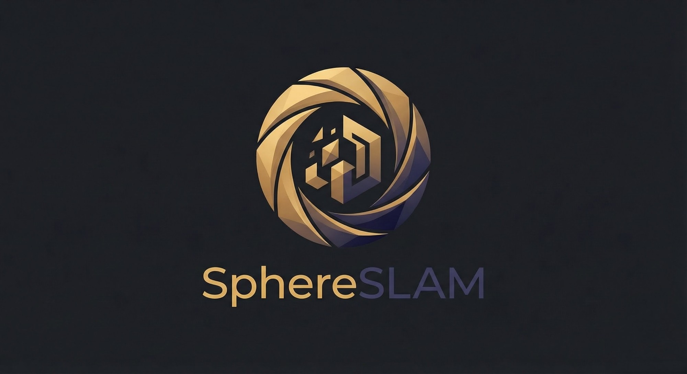

Lightweight markerless 6-DoF tracking and relocalization for Android, including devices where ARCore
is unavailable or undesirable.

SphereSLAM has two layers:

1. **Planar KPM** — natural-feature tracking of one or more rectified planar references in one
   canonical wall frame. This is the supported consumer API in `:sphereslam`.
2. **Photosphere / depth relocalization** — orientation-indexed tiles, a standalone photosphere
   tracking runtime, PnP relocalization, robustness gates, depth-backed triangulation building blocks,
   and relock seeding. This lives in `:reloc` and is intentionally experimental while its
   OpenCV-facing surface evolves.

Around them sit a display-rate coverage overlay (`:overlay`), attitude extrapolation and per-draw pose
prediction (`:sphereslam` `attitude`), and optional on-device models (`:models`).

## API status

SphereSLAM is **pre-1.0**. There is no fictitious “frozen since 1.0” contract.

| Module | Status | Intended use |
| --- | --- | --- |
| `:sphereslam` | **Supported pre-1.0 API** | Planar tracking, standalone tracking, ARCore sidecar tracking, coverage, placement, attitude |
| `:overlay` | **Supported pre-1.0 API** | Optional coverage-glow UI |
| `:reloc` | **Experimental** | OpenCV-backed photosphere tracking / relocalization primitives |
| `:models` | **Experimental** | Optional model helpers: MiDaS depth on LiteRT GPU, SuperPoint / Zero-DCE on ONNX Runtime ([models](docs/MODELS.md)) |
| `:core:common` | **Internal** | Native loading/implementation support |
| `:core:nativebridge` | **Internal** | JNI/KPM bridge |

The internal modules are compiler-gated with an error-level opt-in marker. Application code should
not depend on them directly.

The complete contract, pose conventions, ownership rules, threading and migration notes are in
[docs/PUBLIC_API.md](docs/PUBLIC_API.md). A step-by-step host wiring guide is in
[App integration](#app-integration) below.

## Build baseline

- JDK 21 toolchain
- Java/Kotlin Android bytecode target 17
- Gradle 9.8
- Android Gradle Plugin 9.4.1
- CMake **4.4.4** exactly (pinned in `gradle/libs.versions.toml`; `CMakeLists.txt` requires it)
- compileSdk 37
- minSdk 26

**Consumers need `compileSdk` 37 too.** The AARs' metadata require it, and that requirement comes
from their dependency on `androidx.core:core` 1.19.x (whose own AAR metadata demands compileSdk 37),
so it would apply even if SphereSLAM's modules declared a lower value.

### Building from source

The native KPM engine is compiled from the **artoolkitX submodule** (`third_party/artoolkitx`, pinned
to `9d487c9f`). Clone with submodules:

~~~bash
git clone --recurse-submodules https://github.com/HereLiesAz/SphereSLAM.git
# or, in an existing clone:
git submodule update --init third_party/artoolkitx
~~~

Without the submodule the native build **fails** (CMake `FATAL_ERROR`) rather than shipping a library
whose KPM never works. For host/JVM-only work that does not need KPM, opt in to stub entry points with
`-Psphereslam.allowKpmStubs=true`: `SphereSlam.isAvailable()` / `isOperational()` then report false
and nothing ever matches.

The Android SDK must provide CMake 4.4.4 (`sdkmanager "cmake;4.4.4"`), or point `cmake.dir` in
`local.properties` at a standalone 4.4.4 install. JVM unit tests never load the native library, but
`./gradlew test` still configures the native build, so it needs the submodule (or
`-Psphereslam.allowKpmStubs=true`).

`libsphereslam.so` links libc++ statically (`ANDROID_STL=c++_static`) and ships no
`libc++_shared.so`, so it never collides with OpenCV's (which `:reloc` brings in) when a consumer
merges native libraries. The native session lifecycle (clone, destroy while matching, single-page
matching, feature cap) is covered by instrumented tests,
`./gradlew :core:nativebridge:connectedAndroidTest` on an arm64-v8a / armeabi-v7a device; the JVM
tests use fakes.

**JitPack** must build with the submodule checked out. `jitpack.yml` does this explicitly: it
materializes the exact gitlink commit into a clean checkout (JitPack's cached submodule gitdirs are
not trusted), downloads and SHA-256-verifies Gradle 9.8.0 and CMake 4.4.4, and points AGP at that CMake.
If you fork the build config, keep those steps; a JitPack artifact built without artoolkitX has a
non-functional native engine.

## Install

~~~kotlin
repositories {
    maven("https://jitpack.io")
}

dependencies {
    implementation("com.github.HereLiesAz.SphereSLAM:sphereslam:<tag>")
    // optional:
    implementation("com.github.HereLiesAz.SphereSLAM:overlay:<tag>") // coverage glow
    implementation("com.github.HereLiesAz.SphereSLAM:reloc:<tag>")   // photosphere tracking (experimental, OpenCV)
    implementation("com.github.HereLiesAz.SphereSLAM:models:<tag>")  // depth etc. (experimental)
}
~~~

## Standalone planar tracking

~~~kotlin
val session = SphereSlamStandaloneSession(
    frameWidth = frameW,
    frameHeight = frameH,
    calibration = SphereSlamCalibration(fx, fy, cx, cy),
)

val anchored = AnchoredStandaloneSession(session)

anchored.base.addReference(
    luma = referenceLuma,
    width = referenceWidth,
    height = referenceHeight,
    referenceWidthMeters = 0.30f,
    physicallyMetric = true,
)

anchored.place(
    OverlayPlacement.anchor(
        panXMeters = panX,
        panYMeters = panY,
        rotationZDeg = rotationDeg,
        halfWidthMeters = artworkWidthMeters / 2f,
        halfHeightMeters = artworkHeightMeters / 2f,
    )
)

anchored.match(frameLuma, timestampNs)?.let { matched ->
    // Column-major content -> camera/view transform.
    val cameraFromContent = matched.cameraFromContent
    val mvp = multiply(projectionMatrix, cameraFromContent)
    drawQuad(mvp, matched.halfWidthMeters, matched.halfHeightMeters)
}
~~~

A null match means no registered page was recognized in that frame. The placement remains retained
and is reapplied after reacquisition.

Lower-level hooks used by the photosphere runtime are public too:
`session.match(luma, timestampNs, PlanarMatchRequest(pageNo, maxCorrespondences))` matches one page
and returns its inlier correspondences (`Pose.correspondences`, rows of frame-pixel `x, y` then page-millimetre `x, y`),
`session.cameraFromCanonical(pageNo, cameraFromPage3x4)` converts an externally solved page pose, and
`session.fork()` clones the session (every registered page) for building a grown atlas on another
thread.

## ARCore sidecar tracking

`SphereSlamTracker` runs KPM asynchronously beside ARCore, through the same `SphereSlamEngine` as the
standalone session (one native owner, one worker thread per session). It does **not** replace ARCore's primary
view matrix.

~~~kotlin
val tracker = SphereSlamTracker()
tracker.configure(
    SphereSlamTracker.CameraModel(
        width = frameW,
        height = frameH,
        fx = fx,
        fy = fy,
        cx = cx,
        cy = cy,
    )
)

tracker.setReference(referenceLuma, refW, refH, refRowStride)

tracker.submitFrame(luma, frameW, frameH, rowStride, timestampNs)

val observation = tracker.latestObservation()
val rawCameraFromPage = observation?.cameraFromPage3x4
~~~

`cameraFromPage3x4` is raw row-major KPM output. It is **not** an OpenGL or ARCore view matrix.

## Coverage glow

Every photosphere tile that still needs an update can be hazed; accepted tiles stay clear, so the
edge of the haze is the edge of what has been scanned. The geometry comes from the `PhotosphereMap`'s
own tiles and nothing else.

The glow is **re-projected on the GL thread on every display frame** from the newest device attitude,
honouring roll and working straight up or down, so it sticks to the scene like a photosphere app's
guide instead of trailing the vision analyzer.

### Rotation convention

Everything is expressed as `worldFromCamera`: a **row-major 3×3** whose **columns are the OpenGL
camera axes** (x right, y up, z backward — the camera looks down −z) written in the
**East-North-Up** world frame of `TYPE_ROTATION_VECTOR`. Build it with:

- `AttitudeExtrapolator.worldFromCameraAt(timeNs, cameraFromDevice, out)` — per frame, interpolated /
  extrapolated to the draw time (the normal path);
- `CoverageGlowProjection.worldFromCamera(deviceToWorld, cameraFromDevice)` — from one
  rotation-vector matrix;
- `CoverageGlowProjection.worldFromCamera(heading, elevation, roll)` — from the
  `CameraAttitudeProvider` / `PhotosphereMap.directionOfPixel` angles, straight up and down included,
  when all three come from one `latestAttitude()` sample.

`cameraFromDevice` is the device-body → GL-camera rotation of the image the glow is drawn over: for a
display-upright preview, `DeviceCameraRotation.cameraFromDeviceForDisplayFrame(displayRotationDeg)`.

### Lens

`CoverageGlowProjection.Lens` describes what the drawn surface shows:

- `Lens.fromIntrinsics(intrinsics)` / `fromIntrinsics(fx, fy, cx, cy, width, height)` — exact,
  including an off-centre principal point. For a `FILL_CENTER` preview pass the intrinsics of the
  *displayed* crop: `CameraFillCenter.intrinsics(frameIntrinsics, viewWidth, viewHeight)`.
- `Lens.fromFieldOfView(horizontalFovDeg, verticalFovDeg)` — centred principal point.

### Renderer (display rate)

~~~kotlin
val attitude = CameraAttitudeProvider(context).apply { start(SensorManager.SENSOR_DELAY_GAME) }
val glow = CoverageGlowRenderer(CoverageGlowRenderer.WHITE, 0.14f).apply {
    fillMode = CoverageGlowRenderer.FillMode.COMPLEMENT_OUTLINED
}
// On layout / camera-intrinsics change:
glow.setLens(CoverageGlowProjection.Lens.fromIntrinsics(CameraFillCenter.intrinsics(frame, viewW, viewH)!!))
// Once (any thread): rotation for the frame being drawn, queried on the GL thread every draw.
val cameraFromDisplay = DeviceCameraRotation.cameraFromDeviceForDisplayFrame(displayRotationDeg)
glow.rotationSource = CoverageGlowRenderer.RotationSource { frameTimeNanos, out ->
    attitude.attitudeExtrapolator.worldFromCameraAt(frameTimeNanos + leadNs, cameraFromDisplay, out)
}
// Whenever the map changes (per keyframe), not per frame:
glow.setRegions(map.currentRegions())
glow.setRegionProgress(map.regionsInProgress()) // tiles being scanned, filling until they open
~~~

- `frameTimeNanos` is in the `SystemClock.elapsedRealtimeNanos()` base (the `SensorEvent.timestamp`
  base). Do not use `System.nanoTime()` or Choreographer time.
- `leadNs = 0` is a good start. A small negative lead (e.g. −30 ms) times the glow to the preview frame
  actually on screen if it visibly leads the camera image during fast pans; the extrapolator
  interpolates inside its history and extrapolates at most 50 ms past the newest sample.
- `setRegions` pre-samples the tiles once (tile edges cut into ≤ 5° segments, seam-exact across
  0/360°); each draw is then one 3×3 multiply per sample (about 70 per 15° × 30° tile at the default 5°
  segments, ~10 000 with the whole sphere hazed), with no allocation. When no
  `rotationSource` is set, push a rotation with `setWorldFromCamera(worldFromCamera)`.
- Use the **same sensor** (`TYPE_ROTATION_VECTOR`, East-North-Up) that stamps keyframe headings, so
  tiles and glow share one world frame. `CameraAttitudeProvider` deliberately stays on the
  magnetometer-fused rotation vector.

### Styles

`fillMode` (live, any thread) picks the style; feed the matching regions:

| `FillMode` | Draws | Feed `setRegions` with |
| --- | --- | --- |
| `TRIANGLES` (default) | flat haze over the supplied tiles | `map.regionsNeedingUpdate()` |
| `COMPLEMENT` | wash over everything except the supplied tiles (holes) | `map.currentRegions()` |
| `OUTLINE` | only a soft glowing band on the needs-update side of each boundary | `map.currentRegions()` |
| `COMPLEMENT_OUTLINED` | `COMPLEMENT` wash plus the `OUTLINE` edge on top | `map.currentRegions()` |

Colour and intensity are live too, from any thread while drawing: `hazeColor` (RGB floats) or
`setHazeColorArgb(argb)`, `hazeAlpha` (wash, default 0.2), `outlineAlpha` and `outlineWidthPx` (edge).
Defaults: hot pink `#FF69B4` at 0.2, `TRIANGLES`.

**Scan progress.** A tile is scanned once 90 % of its area has been in frame across any number of
keyframes (`PhotosphereMap.recordView`, called by `PhotosphereKeyframeStore.record`), not when a single
frame happens to hold it. While it fills, `setRegionProgress(map.regionsInProgress())` draws it more
opaque — from the wash toward `progressAlpha` (default 0.85) in ten steps, in every style — and once
scanned it leaves the progress list and opens to the camera.

**The whole sphere.** `PhotosphereMap()` and `SphereCoverage()` default to every heading and every
elevation — 24 × 6 tiles of 15° × 30° — so the ceiling, the floor and what is behind the start can be
scanned. Pass narrower arcs only for a deliberate front-only target.

### Hosting

- **Inside your own GL renderer** (beneath the artwork): `createGlResources()` in `onSurfaceCreated`,
  `drawEmbedded()` (or `drawEmbedded(frameTimeNanos)`) in `onDrawFrame`, `releaseGlResources()` on the
  GL thread when done. It never clears, blends premultiplied into the bound framebuffer/viewport and
  restores the GL state it touches; complement/outline styles use a private offscreen mask, so no
  stencil or depth buffer is needed. On ES 3 it draws in its own VAO (host vertex state untouched);
  on ES 2, re-specify any vertex-attribute pointer you keep on the glow's attribute location after the
  call (GLES20 cannot read pointers back). After a context loss call `onGlContextLost()`.
- **As a drop-in view** above the preview, `:overlay`'s `CoverageGlowView`:

~~~kotlin
val haze = CoverageGlowView(context)
parent.addView(haze) // above the camera preview
haze.renderer.setLens(lens)
haze.trackAtDisplayRate { t, out -> attitude.attitudeExtrapolator.worldFromCameraAt(t, cameraFromDisplay, out) }
haze.updateRegions(map) // per keyframe; feeds the regions the current fillMode draws from
~~~

  Change the style with `haze.setFillMode(mode, map)` (or set `renderer.fillMode` and call
  `updateRegions` again): TRIANGLES takes `regionsNeedingUpdate()`, the COMPLEMENT / OUTLINE styles
  `currentRegions()`.

### Pure projection

`CoverageGlowProjection` is usable without the renderer:
`projectRegions(regions, worldFromCamera, lens)` returns NDC triangles,
`project(directions, worldFromCamera, lens)` places point marks, and
`prepareRegions(regions)` → `PreparedRegions.projectInto(worldFromCamera, lens, out)` is the
allocation-free per-frame form.

**Deprecated:** `CoverageGlowProjection.projectRegions(regions, heading, elevation, hFov, vFov)` and
`CoverageGlowView.update(map, heading, elevation, hFov, vFov)`. They still work unchanged, but build a
horizon-levelled camera (ignoring roll), return nothing near straight up/down, assume a centred
principal point, and only move when called. Migrate to `worldFromCamera` + `Lens`.

## Display-rate pose prediction

A vision solve lands tens of milliseconds after its frame, at analyzer rate. `attitude.DisplayPosePredictor`
holds the latest vision pose with the attitude **at its frame** and, on every draw, rotates it by the
attitude change since then (camera centre held — the gyro-bridge math, but without re-referencing, so
it never accumulates). Rotation, the dominant motion of a hand-held phone, then follows the device at
display rate; translation still updates at vision rate.

~~~kotlin
val predictor = DisplayPosePredictor()
// analyzer thread, per solved frame (column-major camera-from-world, GL eye frame):
predictor.update(cameraFromWorld, frameAttitudeQuaternion, cameraFromDevice, frameTimestampNs)
// GL thread, per draw:
if (predictor.predictInto(attitude.attitudeExtrapolator, SystemClock.elapsedRealtimeNanos(), viewOut)) draw(viewOut)
~~~

With `:reloc`'s `PhotosphereTrackingSession`, just set `session.displayPosePredictor = predictor`: every
rendered pose is published to it with its frame's attitude and `cameraFromDevice`, and it is cleared
whenever a frame yields no pose. The predictor and the extrapolator must use the same attitude sensor
as `Frame.attitude`. Both are thread-safe and their `*Into` / `*At` reads allocate nothing.

## Standalone photosphere tracking (`:reloc`, experimental)

For a phone without ARCore, `PhotosphereTrackingSession` is the whole frame-in / pose-out runtime:
a base photosphere pose from device attitude, a planar KPM precision layer rebased into it, a gyro
bridge across short misses, a self-growing multi-page atlas, and photosphere localization that keeps
the artwork placed with no wall in view.

~~~kotlin
val tracking = PhotosphereTrackingSession(
    PhotosphereTrackingSession.Config(timestampSource = CameraTimestampSource.REALTIME),
    PhotosphereTrackingSession.Callbacks(
        onKeyframe = { keyframe -> mapLock.withLock { keyframeStore.record(keyframe, nowMs) } },
        onMapFromFingerprintSolved = { persist(it) }, // hand it back via updatePrecisionLayer(…, mapFromFingerprint = it)
        onDiagnostic = { Log.d("SphereSLAM", it) },
    ),
)
tracking.displayPosePredictor = predictor
tracking.updatePrecisionLayer(PhotosphereTrackingSession.ReferenceImage(luma, w, h))
// per display-upright analysis frame:
val cameraFromDisplay = DeviceCameraRotation.cameraFromDeviceForDisplayFrame(displayRotationDeg)
val snapshot = attitude.latestAttitude()
val result = tracking.onFrame(
    PhotosphereTrackingSession.Frame(
        luma = packedLuma, intrinsics = frameIntrinsics, timestampNs = image.imageInfo.timestamp,
        attitude = attitude.latestSample(),
        cameraFromDevice = cameraFromDisplay,
        // One snapshot: near a floor or ceiling the angles only mean something together.
        headingDeg = snapshot?.headingDeg, elevationDeg = snapshot?.elevationDeg,
        rollDeg = snapshot?.let { CameraAttitudeProvider.cameraRollDegrees(it.deviceToWorld, cameraFromDisplay) },
        convertDurationNs = convertNs,
    ),
)
result.pose?.let { draw(it.cameraFromMap, it.projection) }
~~~

### Matching speed

`Config.matchSpeed: KpmMatchSpeedConfig` sets how much KPM work each frame costs (all on by default):

- **Downscaled matching** — KPM matches a box-filtered half-resolution luma (`matchDownscale = 2`,
  never below a 240 px short side) with intrinsics scaled to match. The pose convention is unchanged.
- **Flow tracking between full solves** — the full solve's inlier correspondences are tracked with
  forward–backward-checked pyramidal Lucas–Kanade and the pose re-solved by PnP against the page's
  reference coordinates (no chained drift). A full KPM solve runs on flow loss or weakness, a gate
  rejection, and at least every 10 frames / 500 ms. Flow poses never grow the atlas.
- **Focused pages** — with a multi-page atlas and a recent lock, the page under the gyro-predicted
  optical axis is matched alone first. If it misses, that frame reports no match and the next full
  solve searches all pages (a frame never pays for both).
- **Oblique rectification** — KPM's features do not survive strong foreshortening, so a wall seen
  from the side never matched. When the predicted view is at least `obliqueRectificationDeg` (30°)
  off the wall's normal, the full solve warps the frame to a virtual camera facing the wall square-on
  (same intrinsics, same distance, aimed where the real optical axis meets it), matches that, maps
  the correspondences back to real pixels and solves the real pose from them. The solve starts from
  the matches' own plane homography as well as the prediction and keeps the fit that explains more of
  them, so the result is exact however rough the prediction: the prediction only chooses the warp.
  The prediction is the gyro-carried last lock, or once lost the photosphere's placement (right in
  rotation, wrong in position after the camera has walked). When it gives no oblique view and direct
  solves have missed three times running, every other full solve rectifies a guessed view instead
  (45° and 65° each way along the wall, then up and down it), so a steep relock does not depend on
  the guess. 0 disables. The virtual view is rendered from the full-resolution frame (2 × 2
  sub-samples per pixel), not its downscaled copy, so the foreshortened side of the wall keeps the
  detail the frame has.
- **Previews** — the reference rendered as the camera may see it, so a lost camera relocks without a
  prediction of where it is. Where from is the **anticipation resolution**
  (`AnticipationResolution(distance, latitude, longitude, roll)`, default 3 × 6 × 2 × 1). Picture a
  half-sphere over the target, the target at its core and the square-on view at its pole: `latitude`
  meridians run from the pole to the equator, cut by `longitude` circles (2 circles: 30° and 60° from
  square-on); a preview is taken at the pole and at every cut, aimed at the core, none on
  the equator (edge-on). `distance` nests that many half-spheres from `anticipationNearestWidths`
  (0.5) to `anticipationFarthestWidths` (4) target widths, evenly in log distance. `roll` takes each
  view turned about its optical axis that many times, evenly from upright (2: upright and upside
  down). KPM matches up to about 30° of viewing angle, so the default's circles 30° apart and
  meridians 60° apart keep every view within reach of a preview. Previews per page:
  `distance × (1 + latitude × longitude) × roll` (39). Each is what this phone's camera (the
  matched image's intrinsics) would see from there, cropped to its frame: a near view large, partly
  out of frame and strongly foreshortened, a far one small (dropped under 64 px). Rendered with
  OpenCV's `warpPerspective` (area-shrunk first when small), each joins KPM as another image of its
  page, every feature's millimetres mapped back through the warp, so a match against one solves the
  real pose directly. They live in a second KPM session built off the camera thread, 4 at a time,
  each batch indexed once (`KpmBridge.reindex`), farthest first (each next view the one farthest from
  those built: the angle between optical axes, a quarter of the full rotation for turns, 30° per
  doubling of size), so a partial build already spreads over the views. KPM checks every image on
  every query, so the live matcher stays fast; the previews are searched on every other full solve
  once direct solves have missed `previewSearchAfterMisses` (2) times running. 0 builds none.
  `previewAtlasPages` previews grown atlas pages too; `previewMaxFeatures` (600) caps each.
  **The sensors do the turning.** The phone's rotation stays right while the target is lost (only
  the position goes stale), and a pure turn needs no position: before a preview search the frame is
  turned square-on and upright by the predicted rotation alone (`previewRectify`,
  `ObliqueRectifier.rotationPlan`: a virtual camera at the real one's centre facing the wall, its
  focal length × the cosine of the obliquity), and the real pose is solved from the matches mapped
  back through the turn. So the turned frame is nearest the square-on previews, and the cuts and rolls
  cover what the sensors get wrong (heading drift) and steep views the turn stretches too far.
  The search is guided by the phone's rotation, which stays right while the target is lost (only the
  position goes stale). Assuming the target is in view, the rotation fixes how the camera sees the
  page: how steep, from which side, how turned. Each preview records the camera rotation it stands
  for, and the first search matches only the `previewNearest` (4) previews nearest the predicted one
  (the angle between the two rotations, plus 30° per doubling of size off the scale the last lock's
  distance predicts). Each missed search adds as many again until every preview is searched; a lock
  starts over. The native side matches a chosen image set with a matcher built from those images'
  features (`KpmBridge.matchPlanarImages`), keeping the 8 most recently used.
  **Throttling** is the library's. The resolution is a maximum
  (`PhotosphereTrackingSession.anticipationResolution`, starting at the config's); the session cuts
  it by battery, heat and its own load, weighted by `AnticipationThrottle(battery, heat, compute)`
  (default ½, 1, ½; `anticipationThrottle`). Pressures, each 0–1: battery its discharge (none while
  charging), heat Android's thermal headroom (full where Android throttles), compute the session's
  frame time from half the camera's frame interval (none) to all of it (full); they come from
  `devicePressure` (`AndroidDevicePressure(context)`; none when unset, so only load throttles). The
  cuts multiply into a factor; every 2 s the session searches the largest subset of the maximum that
  fits (`AnticipationDecimation`: every other meridian, circle, half-sphere or roll, and so on, each step a
  subset of the one before), lower at once, higher after it has fitted for 10 s. Throttling builds
  nothing and lifting it reuses what was built; a new maximum builds only its new views.
  `PhotosphereTrackingSession.anticipation` reports the effective resolution and the pressures. All
  three settings apply from the next frame, without a restart.
- **Reference scale** — a reference far larger than the matched frame (a full-resolution camera
  still against a 320 × 240 match) leaves the wall outside KPM's scale range. A page is registered
  from an area-downscaled copy whose long side is at most `maxReferenceScale` (3) × the matched
  image's long side; its millimetre geometry is unchanged. Keep the full-resolution original
  wherever you persist it; 0 registers references as given.

`TrackedPose.matchMethod` (`VisualMatchMethod.KPM_FULL`, `KPM_FOCUSED`, `FLOW`, `KPM_RECTIFIED`) says which path
produced a pose. `KpmMatchSpeedConfig.FULL_KPM_EVERY_FRAME` restores a full-resolution all-pages
solve on every frame.

**Flow tracking needs OpenCV's native library** (`System.loadLibrary("opencv_java5")`, as for
`Relocalizer`). Without it flow switches itself off and every frame takes the full KPM path, so a host
that forgets to load OpenCV silently loses most of the speed-up.

### Background atlas worker

The analyzer thread never builds a matcher. The initial build, rebuilds after a reference or
intrinsics change, and every atlas-growth attempt (rectification, quality gate, page feature
extraction, index rebuild) run on the session's private background thread. Growth **forks** the live
matcher (`SphereSlamStandaloneSession.fork()`, a native clone of its atlas), adds the page to the fork
while `onFrame` keeps matching on the live one, and swaps the grown matcher in at the start of a later
frame; a rejected page just drops the fork. All callbacks still fire on the `onFrame` thread.

Behaviour to expect:

- **`result.pose == null` until the first build lands** (and briefly after an intrinsics change);
  frames meanwhile carry the base pose (`FrameResult.baseCameraFromMap`) only.
- **A too-weak reference fails on the frame after its build**, not the frame that requested it
  (`ReferenceTooWeakException` → `TrackingState.FATAL`, `Callbacks.onFatalError`, failure severity
  `RECOVERABLE`). Only the precision layer stops: frames keep returning the base pose and keyframes,
  `isRecoverable` is true, and the next `updatePrecisionLayer` with a different reference (or changed
  pages, or `forceRebuild = true`) resumes with the base map intact.
- **Every precision-layer rebuild starts unconfirmed.** A new or dropped reference, a different
  `map_from_fingerprint`, a changed page set, `forceRebuild` or an intrinsics change resets the
  tracking state to `INITIALIZING`; the next lock needs `confirmationFrames` accepted frames before a
  pose is drawn or `map_from_fingerprint` is solved.
- **`updatePrecisionLayer(reference)` with no map keeps the map the session already solved for that
  same reference**; a host-supplied map overrides it, and a new reference re-solves on its first
  confirmed lock.
- **The wall is one tile of the photosphere.** Keyframes become tiles of the current *station*
  (standpoint). A tile recognised in the live frame fixes the camera rotation visually (correcting
  gyro/compass drift); with `map_from_fingerprint` known that places the artwork off the wall
  (`PoseSource.PHOTOSPHERE`; the gyro-carried last lock, `PoseSource.HELD`, only without tile
  localization). The first wall lock relates the gyro frame to the map: nothing is captured or placed
  from the photosphere before it. When the camera is more than `stationSpawnDistance` (metres for a
  metric reference, reference widths otherwise) from every station a new station opens and the
  earlier photospheres are kept: tiles looking the same way from two standpoints are triangulated
  into landmarks and a plane per tile, giving a full 6-DoF fix from anywhere and predicting how each
  tile looks as the device moves. A station keeps at most 64 tiles, oldest dropped first — except
  its **anchor tiles**: those within 24° of the direction its first lock was made from — the tiles
  viewing the wall and the ring bordering them — are never dropped, so the wall's surroundings stay recognisable however long the artist works
  away from it, and the artwork is re-found as the wall swings back into view. Needs OpenCV (ORB); without it tile localization disables itself
  once. Turn off with `Config(tileLocalization = false)`; `Config(holdOffWall = false)` restores "no
  pose past the bridge".
- **Monocular depth for tiles.** Pass a `TileDepthSource` (MiDaS through `:models`) so tiles get 3D
  points from the first station on — calibrated to the wall plane, triangulated landmarks and
  overlapping tiles:

  ~~~kotlin
  val tracking = PhotosphereTrackingSession(config, callbacks, tileDepthSource = TileDepthSource { luma, w, h ->
      depth.estimateLuma(luma, w, h)?.let { TileDepthMap(it.width, it.height, it.data) }
  })
  ~~~

  It is called on the session's tile worker once per new tile (after the spacing gate). The wall is a
  depth reference only where a ray meets it within its pages' extent. A wall seen head-on has one depth, so
  MiDaS's scale and shift can't both be solved from it: its wall-consistent features are placed on the
  wall, and the full calibration follows once a reference with depth spread exists.
- **`atlasPages` is the complete page set.** Pass `tracking.atlasPages` (or equal copies) back to keep
  the pages the session grew; any other set rebuilds the matcher from exactly those pages. Grown page
  numbers are never reused.
- **A growth attempt that throws is a diagnostic** (`atlas growth failed …`), not a fatal error.
- `Frame.luma` is not retained after `onFrame` returns, so the host may reuse a pooled buffer.

### Diagnostics

Every `metricsIntervalMs` (5 s) `Callbacks.onDiagnostic` receives a KPM line — the last accepted match
(`page inliers error ageMs matchMs method=`) or `KPM no-lock` — followed by per-stage timing over the
window, as `mean/max` milliseconds:

~~~text
SphereSLAM standalone KPM page=0 inliers=87 error=3.1 ageMs=41.2 matchMs=18.4 method=FLOW timing{frames=150 attempts=150 matched=141 convertMs=1.2/2.9 setupMs=0.3/1.1 matchMs=11.7/38.0 keyframeMs=0.4/6.2 growthMs=0.1/0.4} tiles{stations=2 active=1 tiles=23 anchored=5 landmarks=412 depthPoints=3180 rotFixes=17 poseFixes=4}
~~~

`tiles{…}` (with tile localization): stations opened, the active one, tiles, anchor tiles, triangulated landmarks,
monocular-depth points, and rotation / 6-DoF tile fixes adopted in the window.

`rect{planned swept kpm solved frontal maxObliq}` (once a full solve has considered rectification):
frames rectified from the prediction (`maxObliq` its steepest, degrees) and from a guessed view, how
many of those KPM matched and how many gave a pose, and predictions too frontal to rectify.

`previews{images features builtMs ready anticipation factor battery heat compute searchable tried
rectified guided solved}` (with previews): reference images the preview session holds (pages and previews),
their features, the time spent building, whether it is searchable; the effective and maximum
anticipation resolution (`3d×3lat×1lon×1roll/3d×6lat×2lon×1roll`), the throttle factor and the pressures behind
it; the previews it allows; and the lost-frame searches made (`rectified` of them on the frame turned
square-on by the sensors, `guided` over only the previews nearest the predicted view) and solved in the window (`method=KPM_PREVIEW`).

`attempts` frames ran the matcher and `matched` of them got a pose back (before gating). `error` is
the mean squared reprojection error in pixels² of the image the pose was solved in (KPM: the
matcher's downscaled image; flow: the full frame), the unit `PoseAcceptanceConfig.maxReprojectionError`
gates. `convertMs` is whatever the host reports through `Frame(convertDurationNs = …)` (its Y-plane
pack/rotate); `setupMs` is matcher adoption plus the frame copy; `growthMs` is the analyzer-side
cost of starting a growth attempt (the work itself runs on the worker).

### Pooled luma

`LumaFrameTransform.packCropAndRotate` returns a fresh array per frame (≈300 KB at 640×480). For an
allocation-free camera loop use either:

- `LumaFrameBufferPool(slots = 2)` — round-robin pooled output. A returned array is overwritten
  `slots` calls later, so keep at most `slots − 1` frames; copy anything retained longer (a keyframe
  list, a queue to another thread). `PhotosphereTrackingSession` and `PhotosphereKeyframe` copy what
  they keep, so they are safe even with `slots = 1`.
- `packCropAndRotateInto(…, destination)` / `packAndRotateInto` — the returned `RotatedLuma.bytes`
  **is** your `destination`; reuse it only once nothing still reads the previous frame.

## Depth (`:models`, experimental)

`DepthEstimator` runs **MiDaS v2.1 Small** (256×256, fp16 weights,
`midas_v21_small_256_fp16.tflite`) on **LiteRT 1.4.2 with the GPU delegate**. If the GPU delegate
cannot be initialised (block-listed device, driver failure, failed warm-up inference) it falls back to
LiteRT's XNNPACK CPU path and logs an error; `activeBackend` says which backend is in use. Output is
MiDaS **relative inverse depth** (larger = nearer). Passed to `PhotosphereTrackingSession` as its
`TileDepthSource`, it gives each new photosphere tile 3D points, calibrated per tile by `:reloc`'s
`DepthScaleFit` against known depths. `RadialDepthPlacement` (off-wall points of a `WallFeatureMap`)
is a building block not yet on the session path.

~~~kotlin
@OptIn(ExperimentalSphereSlamModelsApi::class)
val depth = DepthEstimator(
    context,
    options = DepthEstimatorOptions(backend = DepthEstimatorOptions.Backend.GPU), // the default
)
depthWorker.execute {
    if (!depth.load()) Log.w(TAG, "depth unavailable: ${depth.lastError}")
    Log.i(TAG, "depth backend=${depth.activeBackend}") // GPU expected; CPU = fallback
}
// later, on the depth worker, with a copy of a tracking frame:
val map: DepthMap? = depth.estimateLuma(lumaCopy, width, height) // ≤ 128 px long side by default
~~~

- The estimator owns its own `SphereSLAM-depth` thread: every method may be called from any thread
  and **blocks** until the model work is done, so call it from a low-priority worker — never from the
  camera analyzer, GL or UI thread. Calls are serialized.
- `estimateLuma` takes a grey plane (e.g. the display-upright tracking luma) with no `Bitmap` round
  trip; `estimate(bitmap)` takes ARGB. The frame is squashed to the model's square input, so map depth
  pixels back per axis (`u·W/N`, `v·H/N`). Copy a pooled luma buffer before handing it to the depth
  worker.
- `DepthEstimatorOptions`: `backend` (`GPU` default, `CPU`), `cpuThreads` (2, for the CPU path),
  `allowFp16Precision` (true), `gpuProgramCache` (true; compiled GPU programs cached under
  `codeCacheDir`, so only the first load pays shader compilation).
- Do not add LiteRT 2.x to an app using `:models` (it drops the delegate API `litert-gpu` 1.4.2
  needs). `:models` ships its own R8 keep rules.
- `SuperPointDetector` and `LowLightEnhancer` stay on ONNX Runtime (CPU).

Model provenance, licence, checksums, accuracy checks and the APK size impact are in
[docs/MODELS.md](docs/MODELS.md).

## App integration

The wiring a host app needs for standalone photosphere tracking with a display-rate glow and artwork.
`attitude` below is one `CameraAttitudeProvider` shared by everything.

**1. Load native libraries (once, e.g. `Application.onCreate`).**

~~~kotlin
System.loadLibrary("opencv_java5") // :reloc flow tracking, Relocalizer, PlanarTracker
check(SphereSlam.isOperational()) // libsphereslam + a calibrated KPM engine (false: no submodule/ABI)
~~~

SphereSLAM never loads OpenCV itself; `:reloc` brings the OpenCV AAR (`org.opencv:opencv`) onto your
classpath.

**2. Attitude sensor.** One `TYPE_ROTATION_VECTOR` source for keyframe headings, `Frame.attitude`,
the glow and the pose predictor, at display-overlay rate:

~~~kotlin
val attitude = CameraAttitudeProvider(context)
override fun onResume() { attitude.start(SensorManager.SENSOR_DELAY_GAME) } // or SENSOR_DELAY_FASTEST
override fun onPause() { attitude.stop() }
~~~

Every sample feeds `attitude.attitudeExtrapolator` with its `elapsedRealtimeNanos` timestamp.
`latestSample()` is defined at the poles; the heading/elevation reads are not.

**3. Renderer setup (GL thread).**

~~~kotlin
val glow = CoverageGlowRenderer().apply { fillMode = CoverageGlowRenderer.FillMode.COMPLEMENT_OUTLINED }
val predictor = DisplayPosePredictor()
@Volatile var cameraFromDisplay = DeviceCameraRotation.cameraFromDeviceForDisplayFrame(displayRotationDeg)

glow.rotationSource = CoverageGlowRenderer.RotationSource { t, out ->
    attitude.attitudeExtrapolator.worldFromCameraAt(t, cameraFromDisplay, out)
}

override fun onSurfaceCreated(gl: GL10?, config: EGLConfig?) { glow.createGlResources() /* + your GL */ }
~~~

**4. `setLens` on layout or intrinsics change** (view resized, camera rebound, display rotated —
also refresh `cameraFromDisplay` then):

~~~kotlin
val shown = CameraFillCenter.intrinsics(frameIntrinsics, viewWidth, viewHeight) ?: return
glow.setLens(CoverageGlowProjection.Lens.fromIntrinsics(shown))
projection = CameraFillCenter.projection(frameIntrinsics, viewWidth, viewHeight)!!
~~~

`frameIntrinsics` are those of the tracked (display-upright) frame, e.g.
`CameraIntrinsicsEstimator.estimate(context, cameraId, w, h)` rotated with `CaptureRotation`.

**Lens distortion.** Every SphereSLAM stage assumes an undistorted pinhole image. Request the
camera's correction on the analysis stream while tracking (API 28+; it applies to every processed
stream, YUV included):

~~~kotlin
val lens = LensDistortion.read(characteristics)
lens.trackingCorrectionMode?.let { mode ->
    camera2Options.setCaptureRequestOption(CaptureRequest.DISTORTION_CORRECTION_MODE, mode)
}
log(LensDistortion.describe(lens, lens.trackingCorrectionMode, frameIntrinsics))
~~~

A camera that cannot correct reports `uncorrected residual≤Npx`: the largest gap, in frame pixels,
between the pinhole model and its lens (`LENS_DISTORTION`, `maxResidualPx`).

**5. Camera analyzer (one worker thread).**

~~~kotlin
val pool = LumaFrameBufferPool(slots = 2)
tracking.displayPosePredictor = predictor

fun analyze(image: ImageProxy) {
    val t0 = SystemClock.elapsedRealtimeNanos()
    val y = image.planes[0]
    val luma = pool.packAndRotate(y.buffer, image.width, image.height, y.rowStride, y.pixelStride,
        image.imageInfo.rotationDegrees)
    val convertNs = SystemClock.elapsedRealtimeNanos() - t0
    val a = attitude.latestAttitude() // heading, elevation and roll of ONE sample
    val result = tracking.onFrame(PhotosphereTrackingSession.Frame(luma.bytes, frameIntrinsics,
        image.imageInfo.timestamp, attitude.latestSample(), cameraFromDisplay,
        a?.headingDeg, a?.elevationDeg,
        // Roll of the tracked (display-upright) image, not of the device's natural +x axis:
        a?.let { CameraAttitudeProvider.cameraRollDegrees(it.deviceToWorld, cameraFromDisplay) },
        convertDurationNs = convertNs))
    image.close()
}
~~~

Use `CameraTimestampSource.REALTIME` in `Config` only when Camera2 reports
`SENSOR_INFO_TIMESTAMP_SOURCE_REALTIME` (frame-age gating depends on it).

**6. `setRegions` on map change.** Feed keyframes into a `PhotosphereKeyframeStore` /
`PhotosphereMap` (from `Callbacks.onKeyframe`) and, whenever the map changes, hand the glow its tiles
(guard map reads with the same lock as its writes):

~~~kotlin
onKeyframe = { kf ->
    val (regions, progress) = synchronized(mapLock) {
        store.record(kf, nowMs)
        map.currentRegions() to map.regionsInProgress()
    }
    glow.setRegions(regions) // regionsNeedingUpdate() for FillMode.TRIANGLES
    glow.setRegionProgress(progress)
}
~~~

**7. Pose prediction per draw (GL thread).**

~~~kotlin
override fun onDrawFrame(gl: GL10?) {
    val now = SystemClock.elapsedRealtimeNanos()
    drawCameraPreview()
    glow.drawEmbedded(now)
    if (predictor.predictInto(attitude.attitudeExtrapolator, now, view)) drawArtwork(projection, view)
}
~~~

`view` is column-major camera-from-map (GL eye frame), the same frame as `TrackedPose.cameraFromMap`.
When nothing is tracked the predictor is cleared and the artwork is hidden (or fall back to
`FrameResult.baseCameraFromMap` for map-anchored content).

**8. Depth (optional, off the analyzer thread).** See [Depth](#depth-models-experimental): load once,
then call `estimateLuma` on a copy of the tracking frame from a separate low-priority worker, never on
the analyzer or GL thread.

**9. Teardown.** `tracking.close()` (native matchers are released on its worker), `glow.releaseGlResources()`
on the GL thread, `attitude.stop()`, `depth.close()`.

## Toolkit packages

`:sphereslam` also ships the pure helpers hosts otherwise re-implement:

| Package | Contents |
| --- | --- |
| `math` | `RotationMath`, `RigidMath` (quaternions, rigid/similarity 4×4, GL ↔ CV flips) |
| `attitude` | `GameRotationAttitudeSource`, `DeviceCameraRotation`, `AttitudeRotationBridge`, `AttitudeExtrapolator`, `DisplayPosePredictor` |
| `camera` | `CameraIntrinsicsEstimator`, `LensDistortion` (correction mode, pinhole residual), `CaptureRotation`, `LumaFrameTransform`, `LumaFrameBufferPool`, `ProjectionMatrix`, `ScreenIntrinsics` (`FIT_CENTER`), `CameraFillCenter` (`FILL_CENTER` projection, tap mapping, FOV) |
| `sidecar` | ARCore + KPM sidecar fusion: `HybridPoseHistory`, `HybridKpmCorrection`, `HybridAnchorFusion`, `MetricPageRectification` |
| `gyro` | `GyroCompensationMath` (gyro-stabilised screen overlays) |

Photosphere capture: `PhotosphereKeyframeStore`, `PhotosphereMap.directionOfPixel` (roll-aware) and
`PhotosphereFingerprintFrame`. The device → camera rotation convention is documented in
[docs/PUBLIC_API.md](docs/PUBLIC_API.md#device--camera-rotation).

~~~kotlin
// Hold a vision pose through a short dropout with the gyro (:sphereslam only).
val attitude = GameRotationAttitudeSource(context).apply { start() }
val bridge = AttitudeRotationBridge(
    DeviceCameraRotation.cameraFromDevice(sensorOrientation, imageRotationAppliedDeg = rotationDegrees)
)
// after each frame whose pose you drew from vision:
bridge.markReference(attitude.latestSample())
// on a frame with no vision pose: rotate the last drawn pose about its camera centre
lastPose = bridge.advance(lastPose, attitude.latestSample()?.quaternion) ?: lastPose
~~~

(`:reloc`'s `RobustTrackingLoop` accepts `bridge.bridgeFunction { attitude.latestSample() }` as its
`bridgeRotatedPose` to do this inside its tracking-state machine.)

## Native availability

The native engine ships for `arm64-v8a` and `armeabi-v7a` only. On any other ABI, on any other load
failure, or in a build without the artoolkitX submodule, `SphereSlam.isAvailable()` /
`isOperational()` return false instead of throwing. `SphereSlam.isOperational()` additionally creates
and closes a calibrated native engine (fail-closed, never throws).

Native KPM sessions are independent: each has its own lock, so a matcher can be built or cloned on one
thread while another session matches on a different thread. One session handle is still driven from
one thread at a time.

## Experimental relocalization API

The `:reloc` module intentionally exposes OpenCV-backed types. Its dependency metadata exports
OpenCV so those signatures are valid for consumers. SphereSLAM does not load OpenCV's native
library itself: load `libopencv_java5` (`System.loadLibrary("opencv_java5")`) before constructing a
`Relocalizer` or `PlanarTracker`, and before the first `PhotosphereTrackingSession.onFrame` if you want
flow tracking.

Using the module produces an opt-in warning. A consumer that knowingly accepts the pre-1.0
experimental contract can opt in:

~~~kotlin
@OptIn(ExperimentalSphereSlamRelocApi::class)
fun useReloc() {
    // ...
}
~~~

Wide-area relocalization: `WallFeatureMap` grows from every successful `RelocResult` and is matched
frustum-gated (`visibleIndices` → `toFingerprint`); `RectifyHomography` pre-cancels oblique
perspective; `MetricMarks` builds metric marks from a known plane or two views; `RadialDepthPlacement`
places off-wall features from a calibrated relative depth map.

`PlanarTracker` is the small case: track one captured reference image and get an OpenGL view matrix
per frame (`setReference(luma, w, h, halfW, halfH)`, then `track(luma, w, h, intrinsics, attitude)`),
with a short gyro bridge across misses.

The optional `:models` module follows the same policy with `ExperimentalSphereSlamModelsApi`.

## Pose naming

SphereSLAM uses transform-direction names instead of ambiguous “pose matrix” names:

- `cameraFromPage3x4`: page -> camera, row-major 3x4 KPM output.
- `cameraFromCanonical`: canonical wall -> camera/view, column-major 4x4.
- `canonicalFromContent`: content -> canonical wall, column-major 4x4.
- `cameraFromContent`: content -> camera/view, column-major 4x4.
- `cameraFromMap`: photosphere base map -> camera/view, column-major 4x4 (`:reloc`).
- `worldFromCamera`: GL camera axes in East-North-Up, row-major 3x3 (coverage glow).

Legacy `viewMatrix`, `viewFromContent`, and `pageToCamera3x4` accessors remain temporarily as
deprecated aliases.

## Test app

`:testapp` is an on-device test bench: a live standalone tracker, a checklist that grades itself from
telemetry (lock on wall, floor and ceiling, match speed, rectified matching, gyro bridge, off-wall
hold, pole attitude, …) and reports every run to this repository's issues. Its tuning kit records
sessions and replays the library over them on the phone under a grid of `Config` values, scoring each
on continuous measures (locked % by viewing angle, relock time, jitter, frame time). See
[docs/TESTAPP.md](docs/TESTAPP.md).

## Project status

- Planar KPM tracking: built
- Multi-page canonical wall frame: built
- Physical-size placement/retention: built
- Angular coverage and display-rate coverage glow: built
- Display-rate pose prediction: built
- Standalone photosphere tracking (downscaled KPM, flow tracking, background atlas growth): built,
  experimental API
- Photosphere freshness/relock loop: built, experimental API
- Depth-backed tiles (MiDaS `TileDepthSource`, cross-station triangulation): wired, experimental API;
  corroboration is a host-side seam
- Full omnidirectional production map-growth pipeline: still evolving

## License

SphereSLAM is licensed under the [Apache License 2.0](LICENSE). Third-party components and their
licenses (artoolkitX — LGPLv3 with a static-linking exception, statically linked into
`libsphereslam.so`; the bundled MiDaS and SuperPoint model weights — MIT; OpenCV, LiteRT — Apache
2.0; ONNX Runtime — MIT) are listed in [NOTICE](NOTICE), with their texts in
[third_party_licenses/](third_party_licenses). Every published AAR carries LICENSE, NOTICE and those
texts under `META-INF/sphereslam/<module>/`.

Provenance: the planar engine originated in HereLiesAz/GraffitiXR and is maintained here as a
standalone reusable library.
